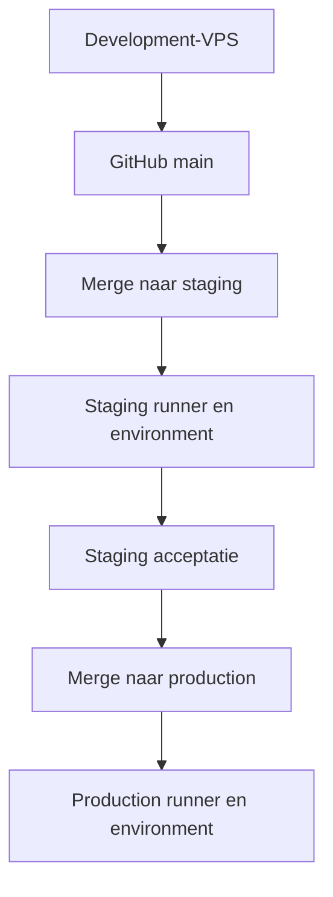

# 07 — Van het exacte Sites-ontwerp naar development, staging en production

## Gewenste werkwijze

De development-VPS wordt de bouwplaats. Codex neemt de complete meegeleverde Sites-broncode en assets als visueel contract, vervangt de prototype-infrastructuur door echte diensten, maakt de volledige V1 werkend en test de UI/UX tegen het origineel. **Niet opnieuw ontwerpen, geen andere componentbibliotheek kiezen, geen vereenvoudigde lookalike maken.** Pas als de afgesproken functies en acceptatiecriteria kloppen, komt het gereviewde resultaat in GitHub `main`.

Nick maakt daarna `staging` en later `production`. Beide branches krijgen een eigen GitHub Environment en eigen self-hosted runner op hun eigen doel-VPS. Een geslaagde merge/push op de desbetreffende beschermde branch start de pipeline; alleen een geslaagde verificatie, build, backup-/migratiegate en healthcheck maakt de deployment succesvol. Een merge alleen betekent nog niet dat de nieuwe site online staat.

Dit pakket maakt **geen** echte repo, branches, runners, credentials of DNS-records aan. De uiteindelijke GitHub repo-URL, VPS-toegang, eigenaar-email en providerkeys ontbreken nog. Geen credentials in het pakket verzinnen. De implementerende Codex kan tot deze punten alles lokaal voorbereiden en testbaar maken.

## Omgevingen en domeinen

| Omgeving | Web | Realtime | Data |
|---|---|---|---|
| Development | lokale/VPN development-origin | lokale/VPN game-origin | lokale Supabase of afzonderlijk development-project |
| Staging | `https://staging.dartspoint.nl` | `https://realtime.staging.dartspoint.nl` | eigen EU Supabase-project, eigen Redis en mailconfig |
| Production | `https://dartspoint.nl` | `https://realtime.dartspoint.nl` | eigen EU Supabase-project, eigen Redis en mailconfig |

Deze subdomeinen zijn een voorgestelde configuratie, niet als bestaande DNS geverifieerd. `www.dartspoint.nl` verwijst canoniek naar `dartspoint.nl`. `dartspoint.app` later toevoegen als aparte launchstap; begin met een redirect naar `.nl` om dubbele content en twee gescheiden cookie-identiteiten te vermijden. Als `.app` later een zelfstandige applicatie-origin wordt, ontwerp auth/redirect/CORS expliciet; cookies delen niet automatisch over twee hoofddomeinen.

Laat de Colyseus SDK verbinden met de HTTPS-realtime-origin; de transportlaag gebruikt veilige WebSockets. Caddy ondersteunt WebSocket-upgrades. Gebruik geen willekeurige `/ws`-pathrewrite zonder Colyseus-routering te controleren.

## 1. Development-VPS: broncode exact overnemen

1. Inventariseer bestaande processen, schijfruimte, RAM, poorten, Node, Docker en Caddy. Maak een eigen werkdirectory. Niet aan andere projecten sleutelen.
2. Pak het broncodearchief uit en verifieer de meegeleverde checksum. Leg de Sites commit-SHA, assets en route-inventaris vast als visueel referentiepunt. Start in een afzonderlijke ontwikkelbranch/checkout.
3. Laat de bestaande UI eerst ongewijzigd werken. Bewaar lettertypes, logo's, beeldassets, CSS, componentopbouw, routes, animaties, responsive grenzen, spelpositionering en interactiestates. Verwijder alleen platform-specifieke build/hostingadapters nadat de native vervanging hetzelfde resultaat geeft.
4. Maak native Next.js Node standalone-output. Haal Sites/Vinext/Worker-/D1-koppelingen uit de runtime wanneer ze in de bron voorkomen; vervang ze inhoudelijk door Node/Postgres-adapters. Niet blind alle `app/api`-routes als statisch exporteren.
5. Introduceer een duidelijk web/realtime/worker/shared-domain-contract. Eén set pure spelregels voor 301 dubbel-in/dubbel-uit, 501/701, busts, finish, legs/sets, Elo en deadlines; de server beslist. UI blijft consumer van hetzelfde semantische model.
6. Vervang lokale demo/sessionStorage-stores per functie door echte auth, API, Postgres en Colyseus. Geen fake login, browser-ownerflag, demo-Elo of localStorage als operationele waarheid meenemen. Veilige lokale UI-voorkeuren en drafts mogen lokaal blijven.
7. Bouw emails/OTP/onboarding en expliciete ownerbootstrap volgens document 03. Geef Nick pas ownerrechten na een geverifieerde emailidentiteit en een auditeerbare operatoractie.
8. Werk featuregewijs de volledige inventaris af. Test desktop, tablet, smal mobiel, landscape, mobiel toetsenbord, reduced motion, reconnect en spectating. Native screenshots vergelijken met Sites op vaste viewportformaten, inclusief drawer/open-menu-states.
9. Draai test-, lint-, type- en buildgates. Bewijs de werkelijke registratie → OTP → eerste gebruikersnaam → lobby → kamer → uitdaging → match → uitslag/Elo-flow met twee geïsoleerde browsers.
10. Commit lockfiles, migrations, tests, docs en inactieve/gereviewde ops-inrichting. Geen secrets of runtimeconfig. Push pas de geaccepteerde volledige implementatie naar `main` in de door Nick bevestigde repository.

Een `.env.example` is documentatie. Werkelijke developmentcredentials blijven op de development-VPS of in een passende secretstore en komen nooit in GitHub main.

## 2. GitHub configureren zodra staging gewenst is

- Maak `main`, `staging`, `production` beschermd: wijzigingen via pull request, vereiste CI, geen forcepush, beperkte bypass. De precieze GitHub-planmogelijkheden controleren bij inrichting.
- CI voor PR's draait op GitHub-hosted of een apart wegwerpbare CI-runner zonder productieprivileges. **Nooit PR-code op de staging-/production-runner uitvoeren.** Gebruik daar geen `pull_request_target`-constructie om ongereviewde code met secrets te draaien.
- Self-hosted runner `dartspoint-staging-01`, labels `self-hosted`, `Linux`, `X64`, `dartspoint-staging`; production overeenkomstig `dartspoint-production-01` / `dartspoint-production`.
- Beperk runnertoegang tot de bedoelde private repo/workflows. Een self-hosted runner is persistent; een aanvaller in een workflow kan de machine blijvend compromitteren. Een runner met Docker-socket of docker-groep heeft praktisch rootprivileges. Gebruik per omgeving een aparte, uitsluitend hiervoor bedoelde host/VM en account.
- Environment `staging` accepteert alleen branch `staging`; `production` alleen `production`. Stel daarin de eigen secrets en variabelen in. De gevraagde automatische deploy na geslaagde merge heeft geen extra handmatige approval nodig; voeg die alleen toe als Nick dat later wil.
- Kopieer de gereviewde `ops/workflow-templates/ci.yml.template` en `deploy.yml.template` naar `.github/workflows/` nadat de build/runtimecontracten werkelijk bestaan. Templates nu nog niet activeren op een onbekende productiehost.
- De deployworkflow heeft `cancel-in-progress: false` en een eigen concurrencygroep per omgeving. Dit voorkomt het afbreken van een actieve drain/migratie. GitHub kan standaard oudere *wachtende* runs vervangen; het is geen FIFO-garantie voor elke commit. De daadwerkelijk uitgerolde SHA blijft altijd expliciet geregistreerd.

## 3. Variables en secrets per GitHub Environment

Zie `ops/environment.example` voor de volledige inventaris. In woorden:

| Naam | Type | Gebruik |
|---|---|---|
| `NEXT_PUBLIC_SITE_URL` | Variable | correcte weborigin en canonical tijdens build |
| `NEXT_PUBLIC_REALTIME_URL` | Variable | exacte externe realtimeorigin |
| `NEXT_PUBLIC_SUPABASE_URL` | Variable | project van uitsluitend deze omgeving |
| `NEXT_PUBLIC_SUPABASE_PUBLISHABLE_KEY` | Variable | publieke clientkey, RLS blijft verplicht |
| `NEXT_PUBLIC_TURNSTILE_SITE_KEY` | Variable | domeingebonden publieke CAPTCHA-key; private secret alleen in Supabase Auth |
| `NODE_IMAGE`, `REDIS_IMAGE` | Variable | reviewed image inclusief vaste SHA-256-digest |
| `MAIL_FROM`, `MAIL_REPLY_TO` | Variable | geverifieerde afzender en bewaakte antwoordmailbox |
| `SUPABASE_SECRET_KEY` | Secret | alleen server; geen clientbundle |
| `DATABASE_URL` | Secret | beperkte app-databaserol, TLS, begrensde pools |
| `MIGRATION_DATABASE_URL` | Secret | alleen migratierol tijdens deploy |
| `RESEND_API_KEY` | Secret | worker voor normale notificatiemails |
| `INTERNAL_DEPLOY_TOKEN` | Secret | interne drain/status/resume-besturing |
| `BOOTSTRAP_OWNER_EMAIL` | Eenmalig operatorsecret | nog op te geven Nick-email; niet in normale deployworkflow |

De SMTP-key voor Supabase Auth wordt **in Supabase custom SMTP** ingesteld. Alleen een mailkey in de VPS-env plaatsen configureert de OTP-bezorging niet. Gebruik afzonderlijke mailkeys/senders voor auth en application notifications, gescheiden per omgeving. Zet DNS SPF/DKIM/DMARC correct en test de daadwerkelijke ontvangst.

Een Supabase serversecret/service-role is nooit een `NEXT_PUBLIC_*`-variabele. Auth/session/JWT-verificatie, RLS en server-side autorisatie worden door een geheime key niet vervangen. Werkelijke secrets worden door GitHub alleen aan de specifieke prepare-stap gegeven; Python schrijft ze zonder shellinterpolatie naar private servicebestanden. Ze gaan niet mee in een image, repository, buildartifact, preview, export of screenshot.

Next zet publieke environmentwaarden in de browserbundle tijdens de build. Daarom bouwt elke deploy **de exacte merge-SHA met de publieke instellingen van dat environment**. De webimage van staging bevat stagingprojectwaarden en mag niet ongewijzigd worden gepromoveerd naar production.

## 4. Doel-VPS eenmalig voorbereiden

De operator controleert eerst de bestaande infrastructuur. Daarna een eigen runneraccount, Docker/Compose (minimaal 2.30 voor `env_file.format: raw`), Python 3 en de bestaande native Caddy-service voorbereiden. Node zelf hoeft voor de voorbeelddeploy niet host-wide wisselend geïnstalleerd te worden: de build en runtime gebruiken de gepinde Node-image.

Maak `/opt/dartspoint/staging` respectievelijk `/opt/dartspoint/production` met eigenaar de bijbehorende runner en mode `0700`. Elke host bevat slechts zijn eigen DartsPoint environment. Webpoort `4300` en gamepoort `42567` zijn alleen loopback, na conflictcontrole. Redis publiceert geen hostpoort. Firewall laat uitsluitend noodzakelijke toegang toe; geen publieke Docker API, Postgres-adminpoort of intern deployendpoint.

Neem de passende Caddy-siteblocks op in de bestaande configuratie, valideer de configuratie en reload gecontroleerd. Niet een complete Caddyfile vervangen als er andere sites op draaien. DNS A/AAAA moet vóór certificaatuitgifte juist zijn. Caddy runtime configuratiewijzigingen kunnen streamingverbindingen beïnvloeden; `stream_close_delay` helpt bij proxyreloads, maar vervangt geen game-drain.

Provision managed Supabase-project en beperkte DB-role, migrations/backupvoorwaarden, custom SMTP en URL-allowlists. Production gebruikt geen stagingproject en staging toont geen echte spelersgegevens. `X-Robots-Tag` plus robots/noindex op staging; `noindex` is geen toegangsbeveiliging. Bescherm staging indien nodig via VPN/app-allowlist en test WebSockets door diezelfde route.

## 5. Wat een deploy exact doet

1. Check exact `github.sha` uit met read-only repositorytoegang.
2. Valideer dat branch/environment/origins/keys/imagereferenties overeenkomen; ontbrekende data stopt de pipeline zonder waarden te printen.
3. Schrijf private configuratie voor web, realtime, worker en migration. Houd de vorige release voor rollback.
4. Exporteer de gecontroleerde SHA met `git archive` naar een schone buildcontext, zonder ignored/untracked runnerbestanden. Bouw dezelfde SHA via lockfile en verificaties, met alleen publieke buildvariabelen. Leg immutable image-ID's vast.
5. Verkrijg een hostlock naast GitHub-concurrency; verifieer dat een echte offsitebackup en recente restoreproef bestaan.
6. Bij bestaande installatie: sluit alleen nieuwe wedstrijdstarts en wacht op nul actieve partijen, nul vliegende/te verwerken darts en nul onbevestigde databasewrites. Huidige spelers mogen afmaken; toernooischeduler respecteert drain.
7. Migreer alleen achterwaarts compatibel via de privileged migrationrole. Geen destructive schemawijzigingen en geen database-downgrade bij rollback.
8. Vervang web/game/worker; Redis blijft dezelfde instantie en versie. Nieuwe processen zien dezelfde gesloten drainstatus.
9. Verifieer web/game readiness met exacte SHA, database/Redis en workerheartbeat. Pas daarna current-release vastleggen en wedstrijdstarts hervatten.
10. Bij fout vóór nieuwe starts: terug naar vorige gezonde images. Zodra een nieuwe release mogelijk al partijen accepteert, eerst opnieuw drainen vóór rollback.

Voor eerste bootstrap bestaat nog geen oude gameserver. Redis start eerst; applicatie-default is maintenance/gesloten; migrations, containers en healthchecks draaien; daarna expliciete resume. Een lege current-symlink mag nooit als algemene reden gelden om een bestaande onbekende productieomgeving zonder inspectie te overschrijven.

De backupgate in het scaffold is bewust geen fake “geslaagd”-script. Codex moet de echte providercontrole invoeren en bewijzen voordat deployment groen kan worden. Neem versleutelde offsitebackups, retentie, hersteltermijn en restoretest op in het operationele dossier. Exacte backups/PITR-mogelijkheden en kosten hangen af van het gekozen Supabase-plan.

## 6. Eerste eigenaaraccount

Het prototype-account “Nick = owner” is geen productieautorisatie. Volg document 03: email verifiëren met echte OTP, gebruikersnaam vastleggen en in een gecontroleerde operatoractie de geverifieerde Supabase-user-ID aan de expliciet opgegeven eigenaar-email koppelen. Een transactie met auditrecord maakt die ene identiteit owner. Nooit “de eerste die zich registreert” owner maken, nooit owner uit clientmetadata of uit het emailtekstveld afleiden.

`BOOTSTRAP_OWNER_EMAIL` is alleen tijdens deze actie nodig. De gewone deploymentworkflow bevat het bewust niet. Voorzie een idempotente CLI, geen publiek bootstrap-API. Geef de CLI een geverifieerde user-ID naast email, controleer de bestaande ownerpolicy en verwijder de bootstrapconfig daarna. Eerst testen op staging; production krijgt zijn eigen expliciete account.

## 7. Acceptatie vóór staging groen mag heten

- Geen afwijking in vaste screenshots op 360/390/768/1440 pixels, inclusief ingelogde desktopverdeling, mobiel bord, laden, menus en drawers. Voeg korte landscape en on-screen keyboard toe. Geen overflow of verborgen primaire actie.
- Werkelijke email-OTP: nieuw/bestaand account, fout/verlopen code, resendtimer, rate limit, providerstoring, twee tabbladen, herstel/herladen, unieke username, geblokkeerde username, onvolledige onboarding mag niet spelen.
- Twee echte clients en toeschouwer: 301 double-in, 501/701, legs/sets, finish, bust, scores pas bij geaccepteerde impact, reconnect, duplicate/out-of-order commando, leaderboard/Elo exact eenmaal.
- Vriendschap/invites/privacy, gesloten privéchat, kamerchat uitsluitend in kamer, rolmenus en moderatie per scope. Clientgemanipuleerde owner/VIP/score wordt geweigerd.
- DartsPoint-events in exclusieve toernooikamer; inschrijving, spectating, knockout/double elimination, planning over meerdere borden, no-show/withdrawal, seizoenen/divisiepromotie volgens het domeincontract.
- Deploy tijdens een echte lopende testpartij: partij wordt uitgespeeld; geen afgebroken throw, foutieve no-show of dubbele Elo. Bij drain-deadline blijft oude versie draaien.
- Healthfail en migrationfail simuleren; oude werkende versie blijft/herstelt. Rollback met nieuwe schema-uitbreidingen testen. Onderbreek een pipeline en voer de operatorherstelprocedure uit.
- Backup terugzetten in een geïsoleerde omgeving en data controleren; nooit een restoretest over production heen uitvoeren.
- Logging/metrics/alerts: mailfail/outboxachterstand, verhoogde reconnects, serverlag, Redisgeheugen, DBpooluitputting, mislukte login/rate limits, schedulerachterstand en failed deploy. Geen OTP of chatinhoud in generieke telemetry.
- TLS, DNS, Supabase allowlists, CORS/origincheck, staging-noindex en productioncanonical, sitemap/socialimages verifiëren vanaf buiten de VPS.

## 8. Van staging naar production

Een stabiele stagingrelease wordt met dezelfde gereviewde code naar `production` gemerged. Productionbuild krijgt productionvariabelen/keys en eigen DBmigrations. Geen stagingdata of staging-owner automatisch kopiëren. Herhaal smoke: homepage → OTP → username → lobby → testmatch → outbox/score/monitoring; gebruik een gemarkeerde ongerankte testpartij om echte ladders niet te vervuilen.

Plan de eerste publieke lancering wanneer monitoring, mailaflevering, backups, beheerlogin en herstelprocedure aantoonbaar werken. Leg een release-SHA, image-ID's, migratieversie en changelog vast. De aangeboden templates stoppen bij ontbrekende voorwaarden; maak zulke gates werkelijk werkend, verwijder ze niet om een groene workflow te forceren.

## Primaire documentatie (gecontroleerd 12 oktober 2026)

- Next.js self-hosting en publieke buildvariabelen: https://nextjs.org/docs/app/guides/self-hosting
- GitHub deployment environments: https://docs.github.com/en/actions/concepts/workflows-and-actions/deployment-environments
- GitHub self-hosted runner hardening: https://docs.github.com/en/actions/reference/security/secure-use
- GitHub concurrencygedrag: https://docs.github.com/en/actions/concepts/workflows-and-actions/concurrency
- Docker Compose env_file/raw: https://docs.docker.com/reference/compose-file/services/#env_file
- Docker socket/groepprivileges: https://docs.docker.com/engine/install/linux-postinstall/
- Colyseus deployment/shutdown: https://docs.colyseus.io/deployment
- Colyseus server lifecycle: https://docs.colyseus.io/server
- Caddy reverse proxy/WebSockets: https://caddyserver.com/docs/caddyfile/directives/reverse_proxy

Deze bronnen onderbouwen infrastructuurgedrag. Het DartsPoint-drainendpoint, backupgate, workercontract en branchmodel zijn het eigen doelontwerp van dit pakket, geen functies die automatisch door Colyseus of Supabase worden geleverd.
